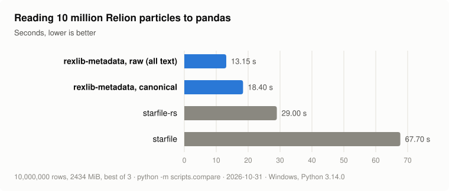
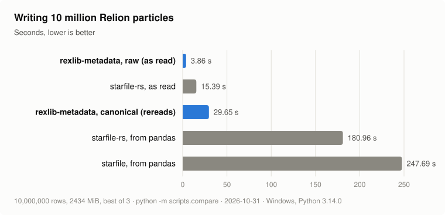
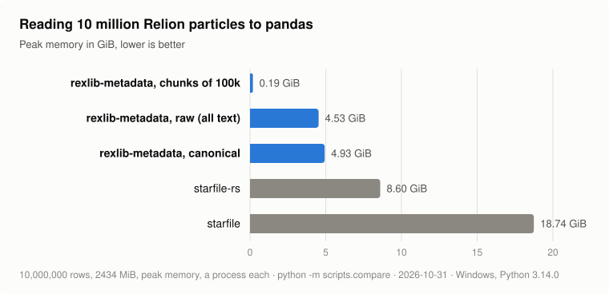
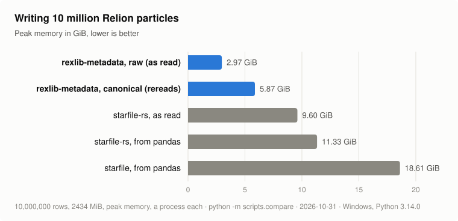

# rexlib-metadata

Highly performant reader and writer of CryoEM metadata formats (STAR, XMD, SQLite, HDF5), to and from Pandas or Polars DataFrames. Rust core, Python API, extensible by design.

[](https://github.com/gigabit-clowns/rexlib-metadata/actions/workflows/build-and-test.yml)
[](https://codspeed.io/gigabit-clowns/rexlib-metadata)

## Features

- **One vocabulary, whatever the file** — a read comes back under canonical column names, typed; `_rlnCoordinateX` and whatever Xmipp calls it both arrive as `coord_x`
- **Read STAR files** to Pandas or Polars DataFrames with a single call
- **Write them back** — `result.write(path)` spells the canonical columns the way the destination format does, carrying over whatever no convention covers; `result.raw.write(path)` writes the file's own names untouched
- **The file's own names too** — `result.raw` is the same read as the format wrote it, every value a string, for when the format is what you are working on
- **Lazy I/O** — `rxm.read()` returns immediately with no file I/O, and so does naming a table; data is only loaded when you call `to_pandas()`, `to_polars()` or `chunks()`
- **Bounded memory** — `result["particles"].chunks(10_000)` streams a file larger than memory, parsing only the columns asked for
- **Extensible** — plug in custom readers and conventions by subclassing Python ABCs; no Rust required
- **Fast core** — parsing and Arrow serialization in Rust via PyO3 + Maturin

Reading and writing STAR files through Relion's conventions is what works today, columns read on their own, chunked reads and forwarding on write included. XMD reads and writes its image reference and angles, and SQLite and HDF5 every table as the file declares it. More of XMD and Scipion's SQLite are on their way — see the [roadmap](docs/roadmap.md).

## Performance

<picture>
  <source media="(prefers-color-scheme: dark)" srcset="docs/assets/performance-read-dark.svg">
  
</picture>

The canonical read is the fair comparison: like starfile and
[starfile-rs](https://github.com/hanjinliu/starfile-rs), it hands back
numbers, and it does so 3.7× and 1.6× faster than they do: on ten million
particles, the size a few days of collection pick, that is 49 s and 11 s
less per read. The raw read does less — every value stays text, as the file
wrote it — so part of its lead is work it does not do.

<picture>
  <source media="(prefers-color-scheme: dark)" srcset="docs/assets/performance-write-dark.svg">
  
</picture>

Each write starts from what its library's read left in memory. Written as
read, the raw write is 4× faster than starfile-rs's. Written from typed
columns, the canonical write is 6× faster than starfile-rs and 8× faster
than starfile writing from pandas — and it reads the source again on the
way, so that every column of the file reaches the destination.

Memory, which ten million particles make as pressing as time:

<picture>
  <source media="(prefers-color-scheme: dark)" srcset="docs/assets/performance-read-memory-dark.svg">
  
</picture>

<picture>
  <source media="(prefers-color-scheme: dark)" srcset="docs/assets/performance-write-memory-dark.svg">
  
</picture>

A whole canonical read holds 3.8× less than starfile and 1.7× less than
starfile-rs. Read a chunk at a time, the same ten million particles take
0.19 GiB, in about the time of a whole read: a file larger than the
machine's memory reads as easily as a small one. A write's peak counts the
read it starts from.

The charts are runs of `python -m scripts.compare --rows 10000000 --svg`,
for time, and of the same with `--measure memory`, each operation in a
process of its own; they generate the file, measure each read and write and
draw them again. Every pull request is also benchmarked through
[CodSpeed](https://codspeed.io/gigabit-clowns/rexlib-metadata), which counts
instructions rather than seconds, against `main`.

## Installation

```bash
# With pandas
pip install rexlib-metadata[pandas]

# With polars
pip install rexlib-metadata[polars]

# Both
pip install rexlib-metadata[pandas,polars]

# HDF5 files, through h5py
pip install rexlib-metadata[hdf5]
```

Requires Python ≥ 3.10.

## Usage

```python
import rexlib_metadata as rxm

result = rxm.read("particles.star")

df = result.to_pandas()   # pandas.DataFrame
df = result.to_polars()   # polars.DataFrame
```

The columns come back under canonical names, typed, whatever the file called
them:

```python
print(df.columns)
# ['image_path', 'image_index', 'micrograph_path', 'coord_x', 'coord_y', ...]

print(df["coord_x"].dtype)
# float64
```

Nothing had to be said about the format. The reader is chosen by the
extension and so are the conventions, which recognise a file by the columns
it has, not by what it is called. A canonical table is named for what it
holds, so a Relion file whose optics live in a block of their own gives two:

```python
result = rxm.read("run_it025_data.star")

result.names               # ('particles', 'optics')
result["particles"].to_pandas()
```

A file of one table needs no name. A file of several asks for one rather
than picking.

Each particle points at its optics group, and `joined` puts the group's
columns on the particle's row, for whoever wants one flat table:

```python
result.joined("particles").to_pandas()   # ..., optics_group, voltage, pixel_size, ...
```

### A file larger than memory

```python
result = rxm.read("run_data.star")

for chunk in result["particles"].chunks(10_000):
    df = chunk.to_pandas()     # ten thousand rows at a time
    ...
```

The file opens when the iteration starts and closes when it ends. Naming the
table reads nothing, so the file is read once and no table of it is kept.
A chunk carries `name`, `len()`, `to_arrow()`, `to_pandas()` and
`to_polars()` — and nothing a chunk cannot do, so there is no `write()` on
it.

`columns=` and chunking compose: a projected chunked read parses only the
columns the projection needs.

### The file's own names

`result.raw` is the same read as the format wrote it: the blocks under their
own names, every column under its own, every value a string. It is what to
reach for when the format itself is the thing you are working on, and it is
the answer when no convention recognises a file.

```python
result = rxm.read("run_it025_optimiser_3D.star")

result.names               # () -- nothing canonical in an optimiser file
result.raw.names           # ('optimiser_general',)
result.raw.to_pandas()     # _rlnOutputRootName, _rlnModelStarFile, ...
```

Type conversion belongs to the conventions and to nothing else: the raw view
infers nothing, and the canonical view is typed because a convention said
what the type is.

### Conventions of your own

A `ConventionBundle` is every convention of one format, grouped by the
canonical table it fills. Pass one to read a file through it instead of
through the registered ones:

```python
from rexlib_metadata.convention import ConventionBundle

mylab = ConventionBundle("mylab", read={"particles": [MyEulerAngles()]})

rxm.read("particles.star", bundle=mylab).to_pandas()
```

A reader and a writer are named the same way, which is what a file needs
when its extension says nothing of its format, or is not registered at all:

```python
from rexlib_metadata.conventions.relion import relion4_bundle
from rexlib_metadata.conventions.star import StarReader, StarWriter

relion = relion4_bundle()
result = rxm.read("particles.txt", reader=StarReader(), bundle=relion)
result.write("out.txt", writer=StarWriter(), bundle=relion)
```

Registering it instead makes it apply to every read of that extension, and
the order is priority — the first bundle to produce a canonical column owns
it:

```python
from rexlib_metadata.registry import global_registry

global_registry.register_bundle([".star"], mylab, prepend=True)
```

### Custom readers

Subclass `Reader` to add support for any format without touching Rust:

```python
from rexlib_metadata.abc import Reader
from rexlib_metadata.convention import RawTable
from rexlib_metadata.registry import global_registry

class MyFormatReader(Reader):
    def read_tables(self, path: str) -> list[RawTable]:
        # parse your format, one RawTable per table the file holds
        ...

global_registry.register_reader([".myext"], MyFormatReader())

# Now rxm.read() dispatches to your reader automatically
result = rxm.read("data.myext")
```

`read_tables` is all a reader has to write, and `write_tables` all a writer
has to. A reader that can skip columns while parsing may also override
`read_tables_keeping(path, columns)`, which `columns=` calls with the raw
names it needs; by default that reads everything and drops the rest. The registry composes them and builds the lazy result, which is what
keeps the file closed until somebody asks for rows.

### Writing

```python
result = rxm.read("run_data.star")

result.write("copy.star")                  # canonical, spelled as Relion does
result.raw.write("verbatim.star")          # the file's own names, untouched
result.raw["particles"].write("one.star")  # just that block
```

The writer and the conventions are chosen by the destination's extension,
exactly as the reader and the conventions of a read are chosen by the
source's. So a conversion is a change of extension:

```python
rxm.read("particles.star").write("particles.xmd")
```

XMD has no optics table, so the optics are joined into each particle's row
on the way, and written as far as Xmipp's conventions spell them.

A column no convention writes — `_rlnCtfImage` and its kind — is carried over
untouched when the destination is the format the result was read from, so
filtering rows and writing them back loses nothing. Numbers are written as
short as they can be while reading back exactly: `587.0` goes out as `587`.

Read only the columns you need, change them, and the write carries the rest:

```python
result = rxm.read("particles.star", columns=["angle_rot"])
df = result.to_pandas()
df["angle_rot"] += 10
result.write("rotated.star", updates=df)   # every other column, untouched
```

A write reads the source again rather than keeping it, so the source has to
be where it was. It writes every table of the file whatever the result
shows, and goes through a temporary file beside the destination, so writing
over the source is safe and a failed write leaves the old file as it was.

## Development

### Requirements

- Python ≥ 3.10
- Rust (stable) — install via [rustup](https://rustup.rs)
- [Maturin](https://www.maturin.rs) — `pip install maturin`

### Build and install locally

```bash
pip install maturin
maturin develop
```

### Run tests

```bash
pip install . --group test
pytest
```

### Run Rust unit tests

```bash
cargo test
```

### Contributing

[AGENTS.md](AGENTS.md) is the place to start: the architecture, the conventions of the codebase and the design invariants, everything needed before writing a line here. [docs/design.md](docs/design.md) goes deeper into the schema and convention layers and the questions still open, and [docs/roadmap.md](docs/roadmap.md) says what comes next.

## SonarCloud status
[](https://sonarcloud.io/summary/new_code?id=gigabit-clowns_rexlib-metadata)

### Ratings
[](https://sonarcloud.io/summary/new_code?id=gigabit-clowns_rexlib-metadata)
[](https://sonarcloud.io/summary/new_code?id=gigabit-clowns_rexlib-metadata)
[](https://sonarcloud.io/summary/new_code?id=gigabit-clowns_rexlib-metadata)
[](https://sonarcloud.io/summary/new_code?id=gigabit-clowns_rexlib-metadata)

### Specific metrics
[](https://sonarcloud.io/summary/new_code?id=gigabit-clowns_rexlib-metadata)
[](https://sonarcloud.io/summary/new_code?id=gigabit-clowns_rexlib-metadata)
[](https://sonarcloud.io/summary/new_code?id=gigabit-clowns_rexlib-metadata)
[](https://sonarcloud.io/summary/new_code?id=gigabit-clowns_rexlib-metadata)
[](https://sonarcloud.io/summary/new_code?id=gigabit-clowns_rexlib-metadata)
